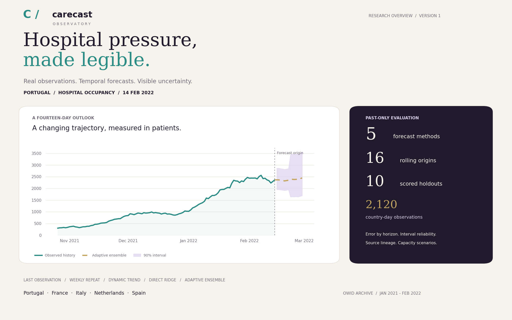

# CareCast Observatory

**A clear view of hospital pressure, forecast uncertainty and planning headroom.**

**[Open the live demo ↗](https://sarvenaz-m.github.io/CareCast-Observatory/)**

[](https://sarvenaz-m.github.io/CareCast-Observatory/)

**Version 1** · Python + R · Five European countries · Real public observations · Offline browser explorer

[Live demo](https://sarvenaz-m.github.io/CareCast-Observatory/) · [Methods](docs/methodology.md) · [Data provenance](docs/data_sources.md) · [Benchmark results](results/metrics.csv)

CareCast is a reproducible study of national hospital and intensive-care occupancy. It combines an attributed historical data snapshot, five forecasting methods, temporal validation, calibrated uncertainty and an interactive planning workspace.

The included observations cover **1 January 2021 to 28 February 2022** in **Portugal, France, Italy, the Netherlands and Spain**. They come from Our World in Data's harmonized compilation of official national reporting. Every displayed forecast has a visible historical origin.

## Explore the evidence

[Explore the live observatory](https://sarvenaz-m.github.io/CareCast-Observatory/) or open `index.html` locally. Data, charts and controls run without accounts, external scripts or access keys.

- Inspect hospital or ICU trajectories and fourteen-day forecasts.
- Compare all five methods on the same evaluation dates.
- Reveal the observed holdout when you want to evaluate a forecast.
- Examine error by horizon and the reliability and width of uncertainty intervals.
- Compare countries using occupancy per million.
- Change a planning threshold and reserve beds to inspect headroom.
- Export the selected forecast and scenario as CSV.

The browser explorer is also compatible with static web hosting. Its source and result links are included in the repository.

## What is implemented

| Component | Design |
| --- | --- |
| Data preparation | Checksum validation; unique country/date keys; daily occupancy alignment; vaccination report lineage |
| Transparent references | Last observation and weekly repeat |
| Time-varying model | Damped local-trend state-space filter with training-only parameter selection |
| Direct forecasting | Recency-weighted regularized regression fitted separately for each forecast horizon |
| Adaptive ensemble | Combines the four base methods using errors from fully completed earlier forecast windows |
| Uncertainty | Sequential empirical calibration with separate short and long horizon bands |
| Evaluation | Sixteen rolling origins; final ten scored; fourteen-day disjoint holdouts |
| Diagnostics | MAE, RMSE, WAPE, baseline skill, empirical coverage, interval width and interval score |
| Independent implementation | Base R reproduces the two references and dynamic local-trend model |

The ensemble's weights and interval calibration use only outcomes that were available at the forecast origin. A more complex method is not assumed to outperform a simpler reference; the complete results remain visible.

## Reproduce

Python 3.11 or later is required.

```bash
python -m venv .venv
python -m pip install -e .
carecast --root .
python -m unittest discover -s tests -v
```

Activate your virtual environment before installing. Rebuilding verifies the bundled observations, regenerates the daily panel, fits the models and writes the browser payload and all analytical results. No network connection is needed.

Run the independent implementation in an environment with base R:

```bash
Rscript R/validate.R
```

It reproduces three base models and checks their point predictions against Python. The included archived R outputs are retained with their verification status.

To recover the same attributed upstream snapshot:

```bash
python tools/refresh_data.py
```

The downloader checks the pinned revision and rejects unexpected bytes.

## Data choice

OWID's historical compilation supplies dense daily occupancy series for the selected countries, matching the forecasting target directly. Its country vaccination reports retain report dates and national source links. This makes the snapshot suitable for a compact, auditable multi-country study.

ECDC offers a useful independent historical source. WHO admissions reporting is valuable for a separate weekly extension. Eurostat bed statistics provide annual resource context. These sources measure different quantities or use different time scales and are not combined into a daily occupancy target. See the [source comparison](docs/data_sources.md#why-this-dataset).

## Interpretation

This is a historical replay of revised published aggregates. It does not recreate the exact data versions available on each original publication date. Country reporting definitions differ.

Vaccination figures provide reporting context; the models do not estimate causal vaccine or policy effects. The capacity control is a user-defined planning threshold, rather than an estimate of national bed capacity. Nominal 90% intervals are accompanied by measured coverage.

The data contain national counts and dates, with no personal clinical records, biological samples, genetic sequences or experimental procedures.

## Project map

| Path | Purpose |
| --- | --- |
| `index.html`, `web/`, `assets/` | Offline explorer and visual identity |
| `src/carecast/` | Data preparation, models and evaluation |
| `R/validate.R` | Independent base-R implementation |
| `data/raw/` | Attributed public observations |
| `data/manifest.json` | Source URLs, pinned revision and SHA-256 hashes |
| `data/processed/panel.csv` | Daily aligned country panel |
| `results/` | Forecast records, benchmark and horizon diagnostics |
| `docs/` | Methods and source definitions |
| `tests/` | Integrity, temporal boundaries and numerical checks |

Code: MIT. Data: retain the original attribution and applicable source terms described in [Data provenance](docs/data_sources.md).


